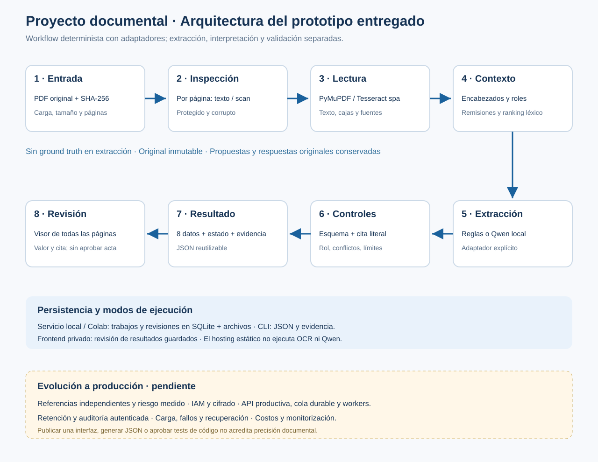

# Arquitectura

La API local recibe un PDF y crea un trabajo. Cada página se inspecciona antes
de leerla: texto utilizable por PyMuPDF, o adaptador OCR cuando corresponde.
Lectura, fuente, coordenadas, rangos y SHA-256 se conservan juntos.

El contexto organiza apertura, cláusulas, numerales e incisos. La recuperación
BM25 propone unidades y expande antecedentes y remisiones únicas. Las reglas
o Qwen proponen los ocho campos. Los validadores comprueban tipos, literalidad
y controles de contexto; la revisión humana permanece separada.

| Componente | Implementación actual | Límite |
|---|---|---|
| Entrada | PDF, máximo 50 MB y 100 páginas | Errores y protección se declaran |
| Lectura | PyMuPDF / Tesseract español | Calidad OCR variable |
| Recuperación | BM25 y estructura | Sin métricas independientes aún |
| Interpretación | Reglas o Qwen opcional | Una propuesta no equivale a aprobación |
| Servicio | HTTP local, SQLite y un worker | Sin IAM ni cola distribuida |
| Interfaz | HTML/JS, IndexedDB y ZIP | Borrador por navegador y origen |
| Complementarios | INE, comprobante y otro | Captura manual; no extractor automático |

El servidor local procesa nuevos PDFs. Un hosting estático sólo muestra y
revisa resultados y fichas locales. No puede ejecutar Python/OCR/Qwen por sí
mismo. El RAG consulta el documento del trabajo; no cruza expedientes de manera
indiscriminada.

Los cambios de nombres internos del código en esta edición son de organización;
los formatos anteriores de respaldo mantienen sus identificadores para poder
reabrirlos. Las métricas antiguas se conservan como resultados archivados y no
se atribuyen a un experimento nuevo de esta edición.
